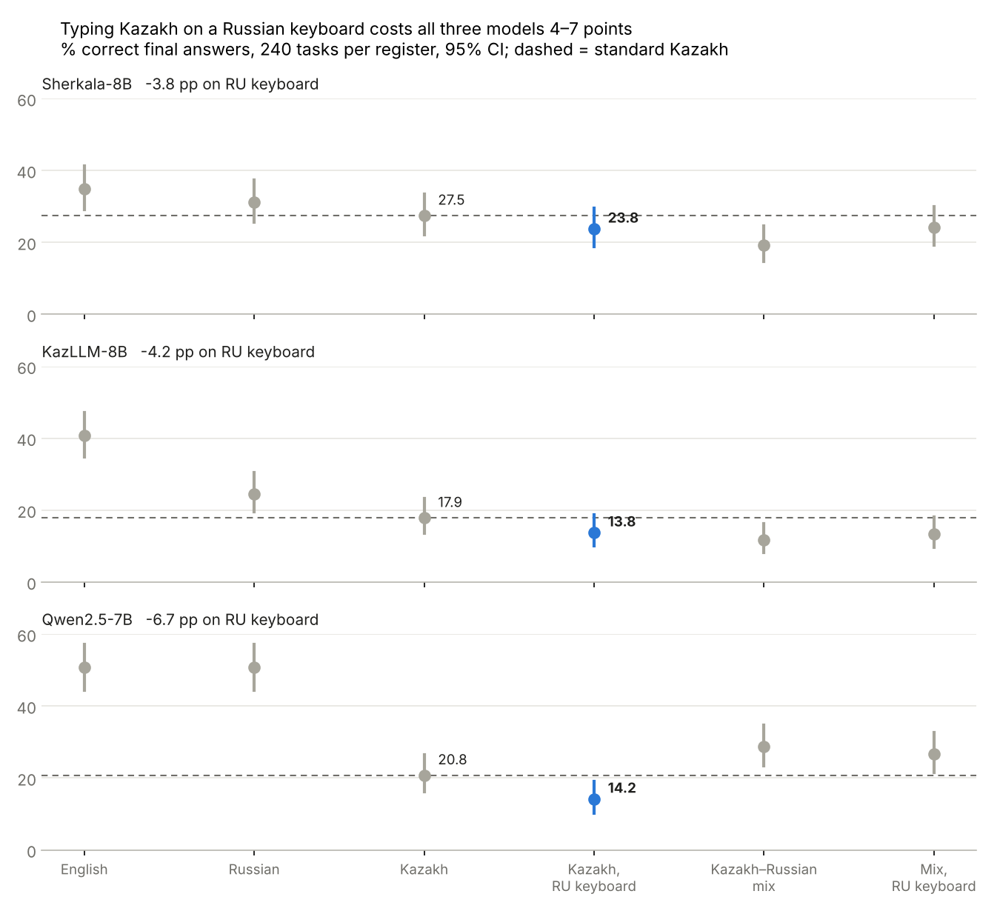

# KazFin-Surface

Do language models reason worse about the same financial task when it is written the way people in Kazakhstan actually type? In everyday writing Kazakh is often typed on a Russian keyboard (the nine Kazakh-specific letters ә ғ қ ң ө ұ ү һ і are replaced by their nearest Russian ones), and Kazakh and Russian are mixed in one sentence.

This repo is a small pilot. Every task exists in six registers with the same numbers and the same gold answer, so a change in accuracy can only come from how the text is written.

| Register | What it is |
|---|---|
| `en` | English, FinChain-style template |
| `ru` | Russian |
| `kk` | standard Kazakh |
| `kk_kb` | `kk` typed on a Russian keyboard (generated) |
| `kk_cs` | Kazakh–Russian code-switched text (hand-written) |
| `kk_cs_kb` | `kk_cs` typed on a Russian keyboard (generated) |

12 templates (simple and compound interest, annuity payment, loan overpayment and balance, contract penalty with a cap, VAT, depreciation, current ratio, ROE, NPV, FX revaluation) × 20 instances × 6 registers = 1,440 tasks. Gold answers were checked independently (numpy-financial; penalties recomputed from the dates in the English text).

## Results, run of 20 November 2026

Three open models, greedy decoding, up to 768 new tokens, final answer counted correct within 1%. Kaggle, 2 × T4.



**Russian keyboard.** Accuracy drops for all three models: −3.8 (Sherkala-8B), −4.2 (KazLLM-8B), −6.7 (Qwen2.5-7B) percentage points. Pooled over the three models it goes from 22.1% to 17.2% (80 tasks became wrong, 45 became right; exact McNemar p = 0.002). Individually only Qwen's drop is significant.

**Code-switching splits the models.** Sherkala and KazLLM lose 8.3 and 6.2 points (p = 0.006 and 0.06); Qwen gains 7.9 (p = 0.009), apparently helped by the Russian terms. On code-switched text the keyboard no longer hurts (+1.5 pooled, p = 0.39), possibly because it leaves the Russian words unchanged.

**Same test on KazMMLU.** The Kazakh part of [KazMMLU](https://huggingface.co/datasets/MBZUAI/KazMMLU) (1,107 questions, up to 100 per subject), asked as published and typed on a Russian keyboard:

| Model | Standard, % | RU keyboard, % | Change, pp | Became wrong / right | McNemar p |
|---|---|---|---|---|---|
| Sherkala-8B | 42.5 | 35.3 | −7.2 | 149 / 69 | 6e-8 |
| KazLLM-8B | 40.1 | 33.7 | −6.4 | 130 / 59 | 3e-7 |
| Qwen2.5-7B | 34.9 | 28.5 | −6.4 | 144 / 73 | 2e-6 |

All tables: [`runs/2026-11-20/analysis`](runs/2026-11-20/analysis). Raw model outputs: [`runs/2026-11-20/preds`](runs/2026-11-20/preds).

## Caveats

- **Preliminary texts.** The Kazakh and code-switched wording has not yet been reviewed by native speakers. Some template-level gaps may be translation problems rather than model failures (contract penalty: 65% correct in English, 2% in Kazakh, pooled over models).
- **Arithmetic floor.** Three loan templates (annuity payment, overpayment, remaining balance) are near 0% in every register, English included; they do not separate registers.
- **Sample size.** 240 tasks per register detects per-model shifts of about 6–7 points; smaller effects show only when pooled.
- **Synthetic keyboard text.** Every Kazakh-specific letter is replaced; real people do it inconsistently (`kk_surface.py` supports partial replacement).
- **KazMMLU scoring.** The option letter is extracted from generated text. Models often answer with Cyrillic letters (Sherkala's «Б» = B); these are mapped. 16–31% of answers contain no letter and count as wrong.
- **Final answer only.** FinChain's step-level ChainEval uses English embedders; Kazakh needs a multilingual one.

## Reproduce

```bash
pip install torch transformers accelerate pandas matplotlib huggingface_hub
export HF_TOKEN=...   # accept the licences of Sherkala, KazLLM and KazMMLU on Hugging Face first
python generate.py --per_template 20            # data/pilot.jsonl (seed 2026, identical to the run)
python run_model.py --model inceptionai/Llama-3.1-Sherkala-8B-Chat --out preds/Llama-3.1-Sherkala-8B-Chat.jsonl
python kazmmlu_flatten.py --model inceptionai/Llama-3.1-Sherkala-8B-Chat --limit 100
python analyze.py runs/2026-11-20               # tables and chart from the saved outputs
```

`notebooks/kazfin_kaggle.ipynb` runs everything on Kaggle (GPU T4 x2, Internet on, `HF_TOKEN` secret). About 2 hours per model.

| File | Role |
|---|---|
| `templates_kk.py` | 12 task templates in six registers |
| `kk_surface.py` | Russian-keyboard flattening |
| `generate.py` | builds `data/pilot.jsonl` |
| `hf_runner.py`, `run_model.py` | batched generation with transformers |
| `kazmmlu_flatten.py` | KazMMLU, standard vs keyboard |
| `score.py` | answer parsing, 1% tolerance, exact McNemar test |
| `analyze.py` | final tables and chart |

## Data and licences

Built on the idea and format of [FinChain](https://github.com/mbzuai-nlp/finchain) (Apache-2.0). Models: [Sherkala-8B-Chat](https://huggingface.co/inceptionai/Llama-3.1-Sherkala-8B-Chat) (CC BY-NC-SA 4.0), [KazLLM-1.0-8B](https://huggingface.co/issai/LLama-3.1-KazLLM-1.0-8B) (CC BY-NC 4.0), Qwen2.5-7B-Instruct. KazMMLU is CC BY-NC 4.0; this repo stores only question ids, gold letters and model outputs for it, not the questions. Research use only.

Notes in Russian: [README.ru.md](README.ru.md).
